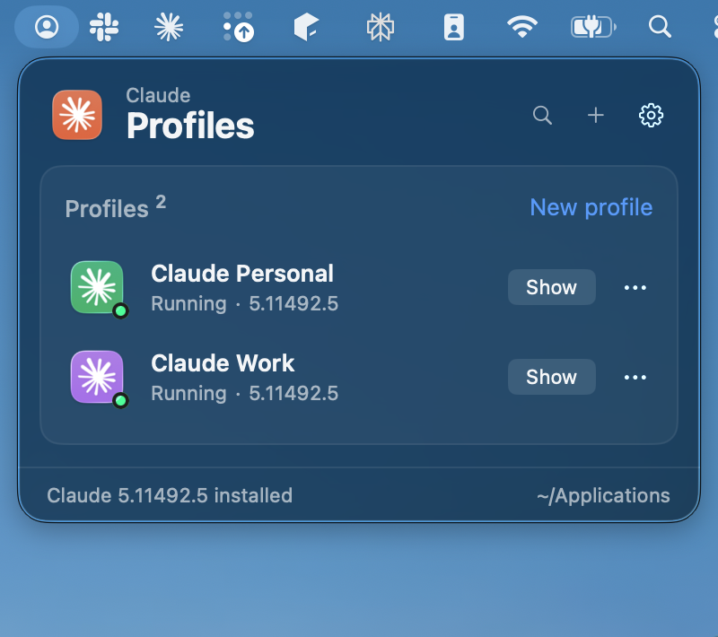
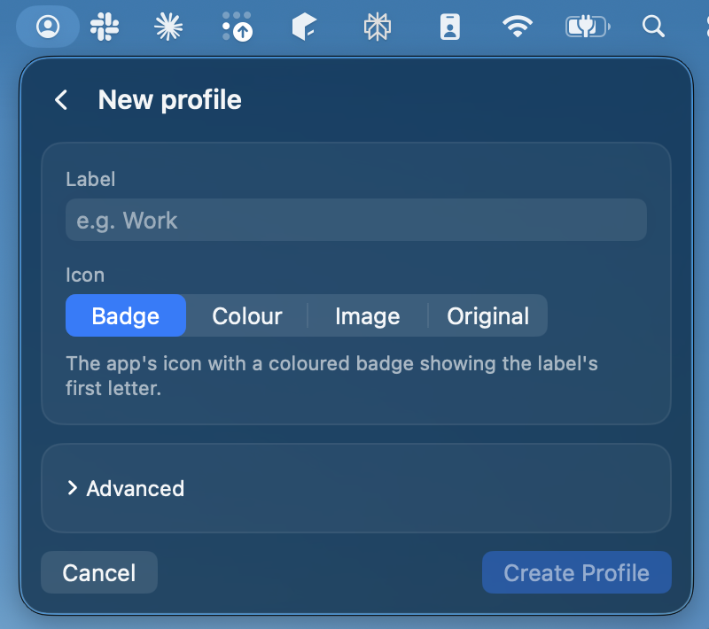

<div align="center">

# claude-desktop-profiles

Run several Claude Desktop accounts side by side, for example personal and work, each signed in.
On macOS every profile is its own app, with its own Dock icon, data and Claude Code settings.

[Quick start](#quick-start) · [Menu bar app](#menu-bar-app) · [Usage](docs/usage.md)

<table>
  <tr>
    <td width="50%"></td>
    <td width="50%"></td>
  </tr>
</table>

</div>

## Quick start

```bash
git clone https://github.com/piotr-liszka/claude-desktop-profiles.git
cd claude-desktop-profiles
./claude-profiles add Work
```

Open `~/Applications/Claude Work.app` and sign in. Your existing Claude stays as it is.

It is one script with no dependencies, using only tools macOS already has. Read it before you run it.

## What a profile gets

| | |
| --- | --- |
| **App** | `~/Applications/Claude <label>.app`: a copy of Claude (an APFS clone, almost no disk space) with its own name and Dock icon |
| **Icon** | Claude's icon with a coloured badge, a whole new colour, or your own image |
| **Data** | `~/Library/Application Support/Claude-<label>`: login, history, settings |
| **Claude Code** | `~/.claude-<label>` instead of `~/.claude` |

The installed Claude is never modified.

## Menu bar app

Does everything the script does from the menu bar: shows profiles that are older than the installed Claude and updates them, lists every profile with its folders, opens and quits profiles, and creates, re-icons and removes them.

```bash
menubar/build.sh --open    # macOS 13+, needs Xcode or the Command Line Tools
```

Or download `Claude-Profiles-Menu.zip` from [Releases](https://github.com/piotr-liszka/claude-desktop-profiles/releases), unzip it into `~/Applications`, then right-click the app and choose **Open** (it is not notarized).

## Commands

```bash
./claude-profiles add Work --color blue   # create a profile
./claude-profiles list                    # profiles and whether they run
./claude-profiles launch Work             # start or show it
./claude-profiles update --outdated --restart   # after Claude updates
./claude-profiles remove Work [--purge]   # remove the app (and its data)
```

All commands and options, updating, icons, Linux and Windows: [docs/usage.md](docs/usage.md).

## Good to know

- Copies do not auto-update. Let only the original Claude update, then run `update` or use the menu bar app.
- Copies are signed ad hoc on your machine. Passkeys, security keys and Microsoft sign-in may not work in a copy; use `add --shared-app` for those.
- If sign-in opens the wrong window, quit the other profile while you sign in.

Unofficial. Not affiliated with or endorsed by Anthropic. Claude is a trademark of Anthropic. MIT license.
